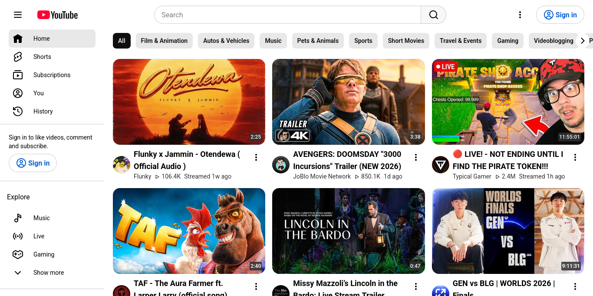
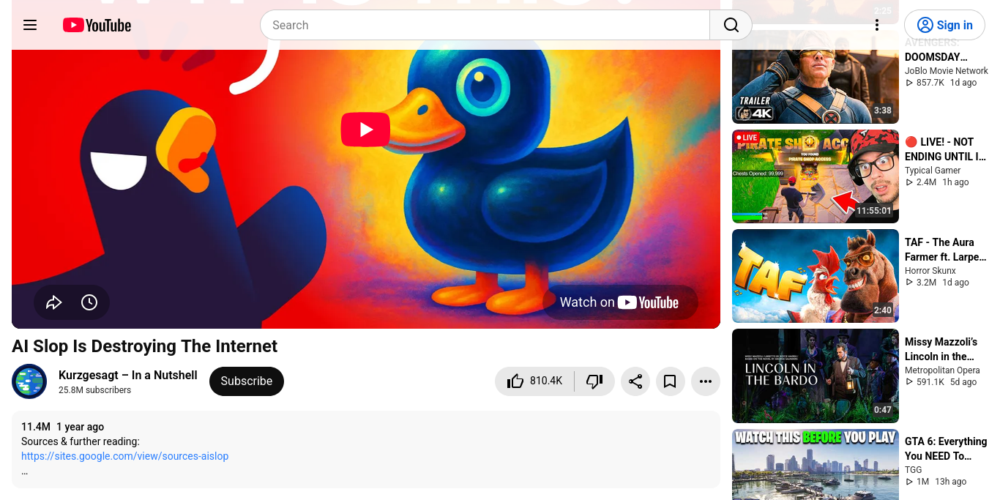

# 🎬 YouTube Clone

A YouTube-inspired video streaming application built with **React**, **Vite**, and **Tailwind CSS**, powered by the **YouTube Data API v3**.

The project recreates core YouTube browsing and watch experiences, with an emphasis on component architecture, state management, and working with external APIs.

## ✨ Features

- 🎥 **Video browsing** — Browse videos across different categories.
- ▶️ **Video playback** — Watch videos through YouTube's embedded player.
- 🔎 **Debounced Search** — Search for videos using the YouTube Data API.
- ⚡ **Caching** — Auto-suggestions are cached during typing
- 📺 **Watch page** — View video details, channel information, and related content.
- 💬 **Comments and replies** — Browse comment threads and their replies.
- 🔴 **Live chat** — Retrieve and display messages from supported live streams.
- 📜 **Pagination** — Load additional content as users browse.
- 📱 **Responsive UI** — Layouts adapted for different screen sizes.
- ⏳ **Loading states** — Skeleton placeholders and loading indicators for asynchronous requests.

## 📸 Screenshots




## 🛠️ Tech Stack

- ⚛️ **React** — UI development
- ⚡ **Vite** — Development server and build tooling
- 🎨 **Tailwind CSS** — Styling
- 🗃️ **Redux Toolkit** — Application-wide state management
- 🧩 **Context API** — Feature-specific state management
- 🧭 **React Router** — Client-side routing
- 🔌 **YouTube Data API v3** — Video, channel, search, and comment data

## 🚀 Getting Started

### 📋 Prerequisites

- Node.js
- npm
- A Google Cloud project with the YouTube Data API v3 enabled
- A YouTube Data API key

### 📦 Installation

1. Clone the repository:

   ```bash
   git clone https://github.com/liningset/youtube-clone
   cd youtube-clone/
   ```

2. Install dependencies:

   ```bash
   npm install
   ```

3. Create a `.env` file in the project root:

   ```env
   VITE_BASE_URL=https://www.googleapis.com/youtube/v3/
   VITE_KEY=your_youtube_api_key
   VITE_SUGGESTIONS_URL=http://suggestqueries.google.com/complete/search
   ```

4. Start the development server:

   ```bash
   npm run dev
   ```

5. Open the local URL provided by Vite.

## 🔑 API Configuration

This project uses the YouTube Data API v3 to retrieve public video, channel, and comment information.

To obtain an API key:

1. Visit the [Google Cloud Console](https://console.cloud.google.com/).
2. Create or select a project.
3. Enable the YouTube Data API v3.
4. Create an API key.
5. Add the key to your local `.env` file.

> ⚠️ **Security note:** Vite exposes variables prefixed with `VITE_` to client-side code. Restrict your API key through Google Cloud Console and remember that it is not secret when used in a browser application.

## ⚠️ Limitations

- 🎞️ Video playback is handled by YouTube's embedded player and remains subject to YouTube's availability, restrictions, and verification requirements.
- 📊 API requests are subject to YouTube Data API quota limits.
- 🤖 Recommendations are approximated using available API data rather than YouTube's proprietary recommendation system.
- 🔒 Some video and live-stream features depend on the availability of their corresponding API resources.

## 📄 License

This project is intended for educational and portfolio purposes. YouTube and its associated trademarks, branding, and content belong to their respective owners.
